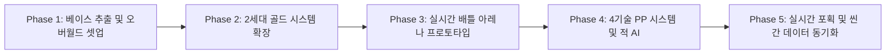

# 포켓몬 골드: 실시간 액션 아레나 (Godot 4) 개발 명세서

> **문서 목적:** 포켓몬 골드(2세대)의 오버월드 시스템과 실시간 1:1 액션 배틀 시스템을 **[설계 → 개발 → 검증]** 프로세스에 맞춰 체계적으로 구현하기 위한 단일 진실 공급원(SSOT) 문서입니다.

---

## 1. 아키텍처 및 시스템 흐름

### 1.1 전체 게임 루프 및 씬 전환

```mermaid
flowchart TD
    subgraph Overworld [오버월드 루프 (2세대 골드 베이스)]
        A[타일맵 16x16 그리드 이동] --> B{상호작용 / 이벤트}
        B -->|NPC 대화 / 표지판| C[대화창 UI]
        B -->|문 / 워프| D[맵 페이드 전환]
        B -->|Start 키| E[메뉴: 가방/포켓몬/리포트]
        B -->|풀숲 진입 주사위 성공| F[인카운터 연출 발생]
    end

    subgraph Transition [씬 전환 매니저 (SceneManager)]
        F --> G[플레이어/배틀 포켓몬 스탯 스냅샷 저장]
        G --> H[전용 배틀 아레나 씬 로드]
    end

    subgraph BattleArena [실시간 배틀 아레나 (탑뷰 액션)]
        H --> I[플레이어 포켓몬 직접 조작]
        I --> J[키보드 8방향 무빙 & 회피]
        I --> K[4개 기술 시전 - PP 소모 / 투사체·히트박스]
        I --> L[실시간 몬스터볼 투척 & 포획 시도]
        K --> M{전투 결과 판정}
        L -->|포획 성공| N[승리 및 데이터 동기화]
        M -->|적 체력 0| N
        M -->|내 체력 0| O[눈앞이 캄캄해졌다 / 포켓몬센터 워프]
    end

    N --> P[오버월드 복귀 및 스탯 반영 (HP, PP, 신규 포켓몬)]
    P --> A
```

### 1.2 핵심 데이터 리소스 구조 (Godot 4 Resource)

```text
res://
├── resources/
│   ├── pokemon/
│   │   ├── PokemonData.gd          # 종족값, 타입, 배울 수 있는 기술 목록
│   │   └── PokemonInstance.gd      # 현재 레벨, 현재 HP, 현재 PP, 개체값
│   ├── moves/
│   │   ├── MoveData.gd             # 위력, 명중률, 최대 PP, 쿨다운, 투사체 씬
│   │   └── MoveInstance.gd         # 현재 남은 PP
│   └── items/
│       ├── ItemData.gd             # 아이템 종류, 포켓 분류, 효과
│       └── Inventory.gd            # 4개 포켓별 소지 아이템 딕셔너리
```

---

## 2. 세부 시스템 설계 (Design Specs)

### 2.1 오버월드 시스템 (포켓몬 골드 2세대 베이스)

| 시스템 | 구현 사양 | 기술적 구현 방식 |
|---|---|---|
| **그리드 이동** | 16×16 픽셀 스텝 이동, 입력 큐잉(연속 걷기), 4방향 전환 | `RayCast2D`로 전방 충돌 검사 후 Tween/Position 스텝 보간 |
| **언덕 점프 (Ledge)** | 특정 방향(주로 아래)으로만 2타일 포물선 점프 | 타일맵 레이어 또는 전용 Area2D 감지 시 `jump_tween()` 실행 |
| **낮/밤 사이클 (시간)** | 새벽(04~10), 낮(10~18), 밤(18~04) 3단계 화면 색조 변화 | 싱글톤 `TimeManager` + 씬 루트의 `CanvasModulate` 색상 보간 |
| **시간대별 인카운터** | 현재 시간대에 따라 풀숲에서 출현하는 포켓몬 목록 및 확률 분기 | `EncounterTable` 리소스에 시간대별 가중치 배열 설정 |
| **4포켓 가방** | 1. 일반 도구 / 2. 몬스터볼 / 3. 기술머신 / 4. 중요한 물건 | `Inventory` 리소스 내 4개 `Array[ItemStack]` 분리 관리 |
| **리포트 (세이브)** | 플레이어 위치, 파티 포켓몬 상태, 가방, 시간 데이터를 JSON 저장 | `user://savegame.json` 파일 읽기/쓰기 |

---

### 2.2 실시간 배틀 아레나 시스템 (핵심 커스텀)

#### A. 조작 및 물리 체계
* **카메라 & 뷰:** 탑뷰 2D 아레나 (가로 320px × 세로 240px 크기의 폐쇄형 링/경기장).
* **스프라이트 에셋 소스 (중요):**
  * 포켓몬 배틀 액터의 8방향 이동 및 액션(대기, 걷기, 공격, 피격) 스프라이트는 **[PMDCollab/SpriteCollab](https://github.com/PMDCollab/SpriteCollab)**의 8방향 애니메이션 시트를 표준으로 사용.
* **플레이어 조작:**
  * `방향키 / WASD`: 8방향 자유 아날로그/디지털 이동 (`CharacterBody2D`).
  * `Z / 1`: 1번 기술 (예: 몸통박치기 - 돌진 근접 히트박스)
  * `X / 2`: 2번 기술 (예: 불꽃세례 - 투사체 발사)
  * `C / 3`: 3번 기술 (예: 째려보기 - 전방 디버프 파동)
  * `V / 4`: 4번 기술 (예: 전광석화 - 순간 대시 공격)
  * `Space / Shift`: 몬스터볼 투척 모드 진입 및 발사

#### B. 4개 기술 시스템 & PP 자원 관리
* **PP(Power Points) 룰:**
  * 각 기술은 시전 시 즉시 해당 기술의 `current_pp`를 1 감소.
  * PP가 0인 기술은 시전 불가 (효과음과 함께 경고 메시지).
  * 연타 남발 방지를 위해 기술별 짧은 **시전 후딜레이(Cooldown)** 적용.
* **판정 구조:**
  * 투사체형: `Area2D` 투사체가 생성되어 전방으로 날아가며 충돌 시 데미지 처리 후 소멸.
  * 근접 돌진형: 포켓몬의 전방 히트박스를 활성화하고 순간적으로 가속.

#### C. 실시간 몬스터볼 투척 및 포획 시스템
* 스페이스바를 누르면 플레이어 조작 포켓몬이 잠시 멈추고 **트레이너 시점의 조준선(Reticle)**이 표시됨.
* 키를 떼면 조준된 방향으로 몬스터볼 투사체(`PokeballProjectile.tscn`)가 포물선 궤적으로 발사.
* **적 충돌 시 포획 판정 공식:**
  $$\text{포획 확률} = \frac{3 \times \text{MaxHP} - 2 \times \text{CurrentHP}}{3 \times \text{MaxHP}} \times \text{CatchRate} \times \text{BallMultiplier}$$
* 포획 성공 시: 흔들림 연출 3회 후 획득 팝업 → 오버월드 복귀.
* 포획 실패 시: 몬스터볼이 깨지며 적 포켓몬이 일시적 분노 상태(공격 속도 증가)로 돌입.

#### D. 적 야생 포켓몬 AI (간이 FSM)
* **Chase (추적):** 플레이어 포켓몬을 향해 이동.
* **Attack (공격):** 사거리 진입 시 보유 기술 중 무작위(쿨타임 있는 것) 시전.
* **Idle/Wander (대기/방황):** 일정 시간 간격으로 방향 전환.

---

## 3. 단계별 개발 로드맵 (Development Roadmap)



### [Phase 1] 베이스 추출 및 오버월드 셋업
1. `SlayHorizon/pokemon-fireleaf-godot` 로컬 클론.
2. 새 프로젝트 폴더 생성 및 불필요한 기존 배틀 코드 배제.
3. 16×16 그리드 이동 스크립트(`Player.gd`) 및 `TileMap` 세팅 검증.
4. 건물 진입 및 워프(Fade In/Out) 동작 확인.

### [Phase 2] 2세대 골드 시스템 확장
1. `TimeManager.gd` 오토로드 싱글톤 추가 (실제 OS 시간 또는 배속 타이머).
2. `CanvasModulate` 연결하여 새벽/낮/밤 색상 틴트 보간 연출.
3. 4개 포켓 인벤토리 리소스 구조 구축 (`Inventory.gd`).
4. 대화창 시스템(텍스트 출력기) 연동.

### [Phase 3] 실시간 배틀 아레나 프로토타입
1. 닫힌 경기장 형태의 `BattleArena.tscn` 씬 생성.
2. 조종 가능한 포켓몬 액터(`PokemonActor.tscn`, `CharacterBody2D`) 제작.
3. 키보드 8방향 자유 이동 및 더미 공격(투사체 1종 발사) 구현.
4. 풀숲 인카운터 발생 시 오버월드 → 배틀 아레나 씬 전환 연동.

### [Phase 4] 4기술 PP 시스템 & 적 AI
1. `MoveData.gd` 리소스 정의 (기술명, 타입, 위력, PP, 투사체 씬 등).
2. 배틀 HUD UI 제작 (체력바, 4개 기술 슬롯 및 잔여 PP/쿨타임 게이지 표시).
3. 기술 시전 시 PP 차감 및 0일 때 시전 방지 로직.
4. 적 포켓몬 AI(추적 및 스킬 시전) 및 피격/무적 시간(i-frame) 구현.

### [Phase 5] 실시간 포획 & 씬 간 데이터 동기화
1. 몬스터볼 투척 시스템 및 피격 판정 구현.
2. 체력 기반 포획 확률 계산식 연동.
3. 전투 종료(승리/도망/패배/포획) 시 오버월드로 복귀하며 변경된 HP/PP/보유 포켓몬 저장.
4. `SaveManager.gd`를 통해 리포트(JSON 저장/불러오기) 구현.

---

## 4. 단계별 검증 체크리스트 (Verification & QA)

| Phase | 검증 항목 | 검증 기준 (Pass 조건) | 확인 방법 |
|---|---|---|---|
| **Phase 1** | 그리드 이동 | 입력 1회당 정확히 16픽셀 이동하며 벽에 끼이지 않음 | 방향키 입력 후 플레이어 좌표값 로깅 |
| **Phase 1** | 언덕(Ledge) 점프 | 난간 위에서 아래 입력 시 2타일 점프, 아래에서 위로는 통과 불가 | 양방향 이동 테스트 |
| **Phase 2** | 낮/밤 색조 | 시간 변경 시 화면의 틴트 색상이 새벽/낮/밤에 맞게 전환됨 | `TimeManager` 시간 강제 변경 테스트 |
| **Phase 3** | 아레나 전환 | 풀숲 조우 시 플레이어 데이터가 온전히 배틀 아레나로 전달됨 | 씬 전환 시 콘솔에 포켓몬 스탯 로그 확인 |
| **Phase 4** | 4개 기술 발동 | 4개 키 입력 시 각기 다른 기술이 나가고 PP가 1씩 감소함 | PP 0일 때 시전 불가 여부 확인 |
| **Phase 4** | 피격 및 데미지 | 공격 투사체 접촉 시 상대 HP가 위력 공식에 따라 감소함 | 데미지 플로팅 텍스트/체력바 갱신 확인 |
| **Phase 5** | 실시간 포획 | 적 체력이 낮을수록 몬스터볼 포획 성공 확률이 정상 증가함 | HP 100% vs HP 10% 포획률 비교 |
| **Phase 5** | 오버월드 복귀 | 전투 중 소모한 PP/체력 및 새로 잡은 포켓몬이 오버월드에 유지됨 | 복귀 후 메뉴 파티창 및 가방 확인 |
